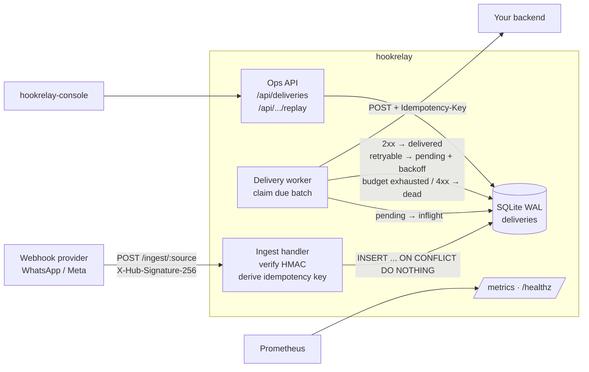
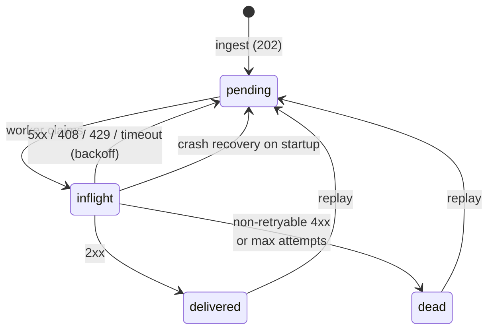

# hookrelay

[](https://github.com/ipenas-cl/hookrelay/actions/workflows/ci.yml)
 

**A small, reliable webhook ingest and relay service in Rust.** It sits between a webhook provider
(WhatsApp Cloud API / Meta, GitHub, Stripe-style senders) and your application. It acknowledges
fast, never loses an event, and gets the event to your backend even when the backend is down.

- 🔐 **HMAC-SHA256 verification** of `X-Hub-Signature-256` (constant-time compare), plus the Meta `hub.challenge` subscription handshake
- 💾 **Durable queue on SQLite (WAL)**: an event is persisted *before* the `202` is returned
- 🔁 **At-least-once delivery** with exponential backoff + jitter, and retry classification (5xx/408/429/network = retry, other 4xx = permanent)
- ☠️ **Dead-letter queue** with a replay API
- 🧷 **Idempotency keys**: provider retries never produce duplicate downstream deliveries
- 📈 **Prometheus `/metrics`** and **`/healthz`**, JSON structured logs, graceful shutdown
- 🖥️ Companion UI: [hookrelay-console](https://github.com/ipenas-cl/hookrelay-console)

## Architecture



### Delivery state machine



## Quickstart

```bash
export HOOKRELAY_SECRET=my-app-secret
export HOOKRELAY_TARGET_URL=http://localhost:9000/webhooks
export HOOKRELAY_VERIFY_TOKEN=my-verify-token   # optional, enables Meta handshake
cargo run --release

# send a signed WhatsApp-style event
BODY='{"object":"whatsapp_business_account","entry":[{"id":"123"}]}'
SIG="sha256=$(printf '%s' "$BODY" | openssl dgst -sha256 -hmac "$HOOKRELAY_SECRET" | cut -d' ' -f2)"
curl -i localhost:8080/ingest/whatsapp -H "X-Hub-Signature-256: $SIG" -H 'content-type: application/json' -d "$BODY"

curl localhost:8080/api/stats
curl 'localhost:8080/api/deliveries?status=dead'
curl -X POST localhost:8080/api/deliveries/1/replay
```

Docker:

```bash
docker build -t hookrelay .
docker run -p 8080:8080 -v hookrelay-data:/data \
  -e HOOKRELAY_SECRET=... -e HOOKRELAY_TARGET_URL=http://backend/webhooks hookrelay
```

## API

| Method | Path | Description |
|---|---|---|
| `POST` | `/ingest/:source` | Signed webhook. `202` new, `200 {"duplicate":true}` seen before, `401` bad signature, `503` could not persist (the provider retries) |
| `GET` | `/ingest/:source?hub.mode=subscribe&hub.verify_token=..&hub.challenge=..` | Meta subscription verification |
| `GET` | `/api/deliveries?status=pending\|inflight\|delivered\|dead&limit=50&before=<id>` | Keyset-paginated list |
| `GET` | `/api/deliveries/:id` | One delivery, including payload and last error |
| `POST` | `/api/deliveries/:id/replay` | Re-queue a `dead` or `delivered` event (resets the attempt budget) |
| `GET` | `/api/stats` | Counts per status |
| `GET` | `/metrics` | Prometheus exposition |
| `GET` | `/healthz` | Liveness and DB check |

Downstream requests carry `Idempotency-Key`, `X-Hookrelay-Source` and `X-Hookrelay-Attempt` so the receiver can dedupe.

## Configuration

| Env var | Default | |
|---|---|---|
| `HOOKRELAY_SECRET` | *required* | HMAC secret (Meta App Secret) |
| `HOOKRELAY_TARGET_URL` | *required* | Downstream endpoint |
| `HOOKRELAY_VERIFY_TOKEN` | unset | Enables the `hub.challenge` handshake |
| `HOOKRELAY_LISTEN` | `0.0.0.0:8080` | |
| `HOOKRELAY_DB` | `hookrelay.db` | SQLite path |
| `HOOKRELAY_MAX_ATTEMPTS` | `8` | Attempts before dead-lettering |
| `HOOKRELAY_BACKOFF_BASE_MS` / `_MAX_MS` | `1000` / `300000` | Exponential backoff bounds |
| `HOOKRELAY_TIMEOUT_MS` | `10000` | Downstream request timeout |
| `HOOKRELAY_POLL_MS` / `HOOKRELAY_BATCH` | `250` / `32` | Worker poll interval and batch size |

## Metrics

| Metric | Labels |
|---|---|
| `hookrelay_ingested_total` | `source`, `result` = accepted, duplicate, bad_signature, unsigned, error |
| `hookrelay_delivery_attempts_total` | `outcome` = success, retry, dead |
| `hookrelay_delivery_duration_seconds` | `outcome` (histogram) |
| `hookrelay_queue_depth` | `status` (gauge) |

Example SLO alert: `sum(rate(hookrelay_delivery_attempts_total{outcome="dead"}[5m])) > 0`. Pair it with [slo-probe](https://github.com/ipenas-cl/slo-probe) for black-box ingest SLOs.

## Design decisions

- **Persist before acknowledging.** Meta retries any webhook that is not acknowledged quickly. Returning `202` only after the SQLite commit means a crash never drops an acknowledged event. If the write fails, a `503` hands responsibility back to the provider.
- **At-least-once, not exactly-once.** Exactly-once across a network is a myth. hookrelay dedupes on ingest using idempotency keys (explicit `Idempotency-Key`, then provider delivery IDs, then a SHA-256 of the body), and forwards the key downstream so the receiver can dedupe too.
- **Why SQLite?** Zero ops, a single file, transactional, and WAL gives concurrent reads while the worker writes. A single node handles thousands of events per second, which covers most webhook volumes. The `Store` boundary is small, so a Postgres (`SELECT ... FOR UPDATE SKIP LOCKED`) backend can be added for horizontal scale.
- **Claim with a state transition.** Jobs move `pending → inflight` inside a transaction, so they can't be double-claimed. On startup, `inflight` rows are recovered to `pending`, which keeps crash semantics simple.
- **Retry classification.** Retrying a `422` forever only burns the budget and hides bugs. Permanent 4xx errors go straight to the DLQ, where they are visible and replayable once fixed.
- **Backoff with jitter** (`[ceil/2, ceil]`) avoids synchronized retry storms when a downstream recovers.
- **Owned Prometheus registry** (no global state), so tests can assert on metric output deterministically.

## Development

```bash
cargo fmt --check && cargo clippy --all-targets -- -D warnings && cargo test
```

The test suite has unit tests (signatures with a known vector, backoff bounds, store state machine, crash recovery). It also has end-to-end tests that run a real HTTP downstream to exercise dedupe, retry-then-success, DLQ plus replay, permanent 4xx, the Meta handshake and metrics.

## License

MIT
